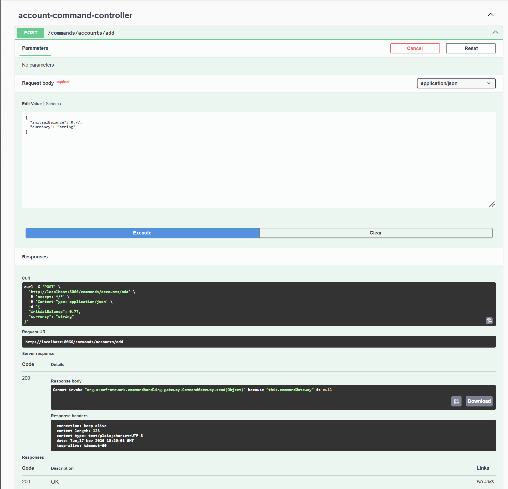
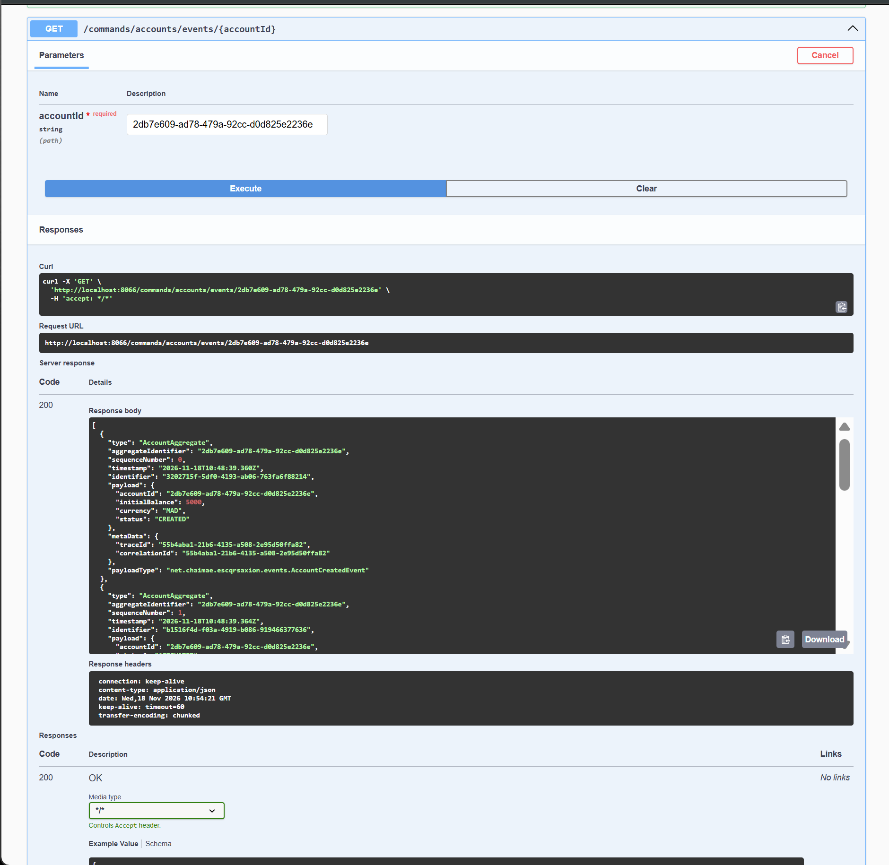
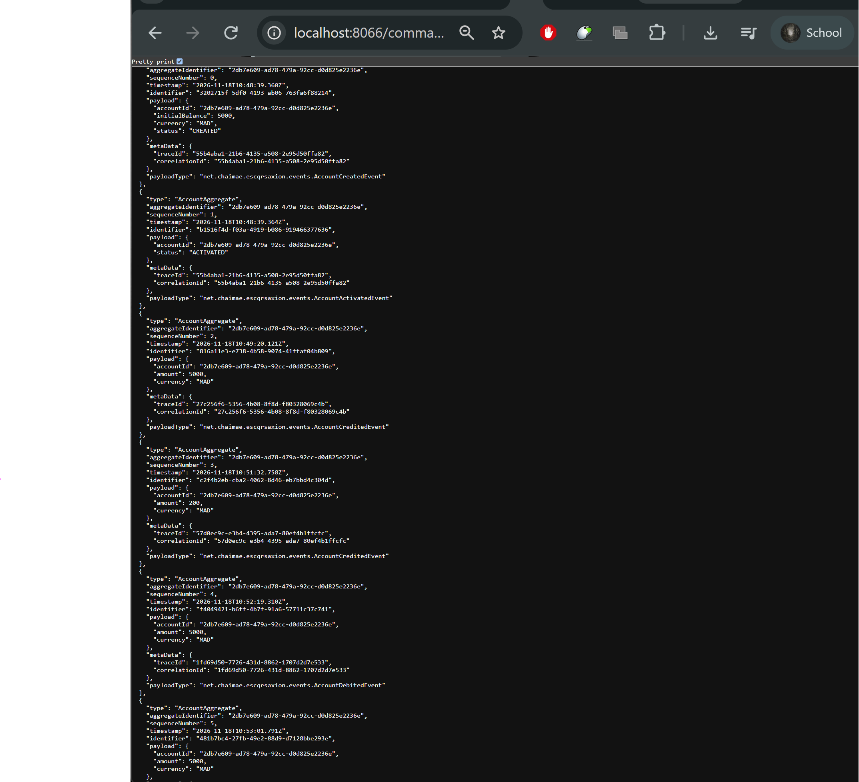
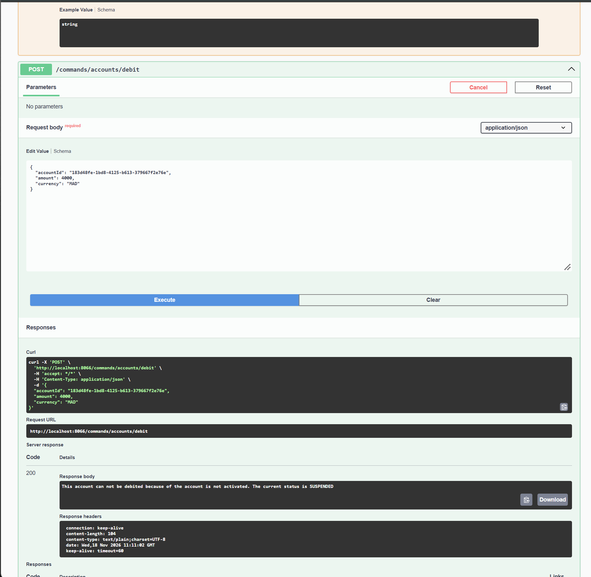
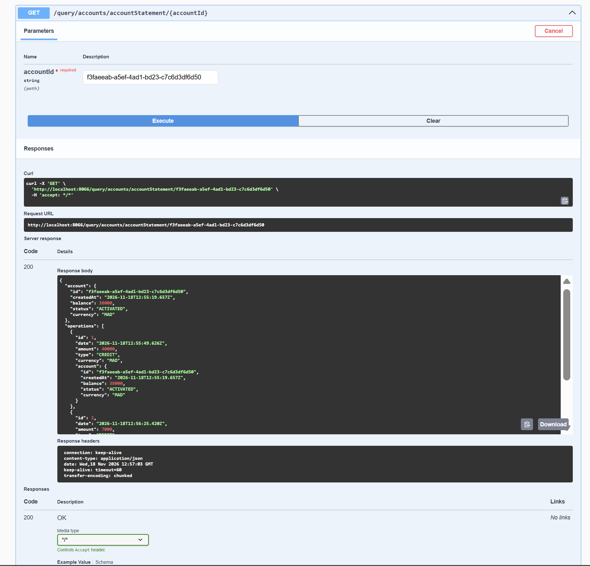
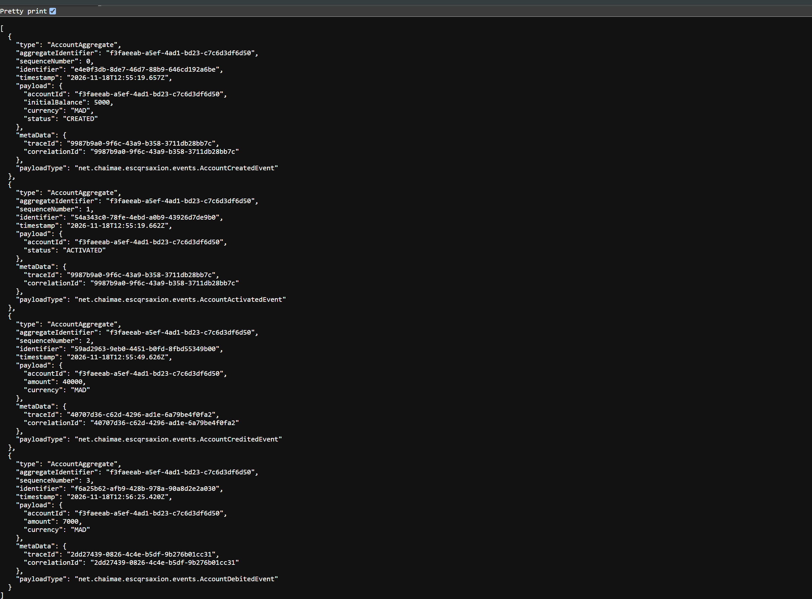

# Gestion de comptes — CQRS & Event Sourcing avec Axon

Application Spring Boot de gestion de comptes bancaires illustrant **CQRS** (séparation des commandes et des requêtes) et **Event Sourcing** avec Axon Framework.

## Fonctionnalités

- Création et activation automatique d'un compte.
- Crédit, débit et modification du statut d'un compte.
- Consultation de l'historique des événements.
- Consultation des comptes et des relevés d'opérations.
- Suivi des opérations en temps réel via Server-Sent Events (SSE).

Les crédits et débits nécessitent un compte activé et un montant strictement positif. Le solde initial ne peut pas être négatif et un débit ne peut pas dépasser le solde disponible.

## Technologies

| Technologie | Version / rôle |
| --- | --- |
| Java | 21 |
| Spring Boot | 3.5.7 |
| Axon Framework | 4.10.3 — commandes, événements et requêtes |
| Spring Data JPA & PostgreSQL | Persistance |
| Project Reactor | Flux réactifs pour le suivi SSE |
| Springdoc OpenAPI | 2.8.13 — interface Swagger |
| Docker Compose & pgAdmin | Services locaux et administration PostgreSQL |
| Maven Wrapper | Compilation et lancement |

## Architecture

```text
Client → API Commandes → CommandGateway → AccountAggregate
                                              │
                                         Événements
                                              │
                                          Event Store
                                              │
                                     AccountEventHandler
                                              │
                                     Projections JPA
                                              │
Client ← API Requêtes ← QueryGateway ← AccountQueryHandler
```

L'agrégat reconstruit son état à partir des événements. Les projections du côté lecture permettent de consulter les comptes et les opérations sans passer par le modèle de commande.

```text
src/main/java/net/chaimae/escqrsaxion/
├── commands/     # Agrégat, commandes, DTO et contrôleur d'écriture
├── events/       # Événements métier
├── enums/        # Statuts des comptes et types d'opérations
└── query/        # Entités, repositories, handlers et contrôleur de lecture
assets/           # Captures d'écran de démonstration
```

## Démarrage local

### Prérequis

- JDK 21.
- Docker et Docker Compose pour PostgreSQL et pgAdmin, ou une instance PostgreSQL existante.

### 1. Démarrer les services

Depuis la racine du projet :

```powershell
docker compose up -d postgres pgadmin4
```

La configuration locale utilise PostgreSQL sur `localhost:5432`, la base `es-accounts_db` et les identifiants de développement définis dans `compose.yaml` et `src/main/resources/application.properties`.

> Le fichier Compose propose aussi Axon Server, mais le connecteur `axon-server-connector` est exclu dans `pom.xml` : Axon Server n'est pas nécessaire à cette configuration.

### 2. Lancer l'application

Sous Windows :

```powershell
.\mvnw.cmd spring-boot:run
```

Sous Linux / macOS :

```bash
./mvnw spring-boot:run
```

L'URL JDBC peut être remplacée via la variable d'environnement `DB_URL`.

> **Attention :** `spring.jpa.hibernate.ddl-auto=create` recrée le schéma au démarrage et peut supprimer les données existantes. Cette configuration est destinée à la démonstration locale.

### 3. Accéder aux interfaces

| Interface | URL |
| --- | --- |
| Application / API | http://localhost:8066 |
| Swagger UI | http://localhost:8066/swagger-ui/index.html |
| Description OpenAPI | http://localhost:8066/v3/api-docs |
| pgAdmin | http://localhost:8088 |

Pour connecter pgAdmin au service PostgreSQL du même réseau Docker, utiliser l'hôte `postgres` et le port `5432`.

## API REST

Les chemins ci-dessous sont relatifs à `http://localhost:8066`.

### Commandes

| Méthode | Endpoint | Description |
| --- | --- | --- |
| `POST` | `/commands/accounts/add` | Créer un compte |
| `POST` | `/commands/accounts/credit` | Créditer un compte |
| `POST` | `/commands/accounts/debit` | Débiter un compte |
| `PUT` | `/commands/accounts/updateStatus` | Modifier le statut |
| `GET` | `/commands/accounts/events/{accountId}` | Consulter les événements |

Exemple de création d'un compte :

```json
{
  "initialBalance": 1000,
  "currency": "MAD"
}
```

La création retourne l'identifiant du compte. Le réutiliser comme `accountId` pour les opérations suivantes.

Exemple de crédit ou de débit :

```json
{
  "accountId": "<accountId>",
  "amount": 100,
  "currency": "MAD"
}
```

### Requêtes

| Méthode | Endpoint | Description |
| --- | --- | --- |
| `GET` | `/query/accounts/all` | Lister les comptes |
| `GET` | `/query/accounts/accountStatement/{accountId}` | Consulter un relevé |
| `GET` | `/query/accounts/watch/{accountId}` | Suivre les opérations en SSE (`text/event-stream`) |

## Captures d'écran

Toutes les captures originales sont conservées dans le dossier [`assets/`](assets/).

### Premiers essais de création de compte




### PostgreSQL et consultation des données


### Création d'un compte


### Crédit d'un compte


### Débit d'un compte


### Historique des événements

Consultation via `/commands/accounts/events/{accountId}` :




### Suspension d'un compte



### Requêtes et suivi en temps réel




### Vérification dans pgAdmin


### Historique final


axon server interface 

