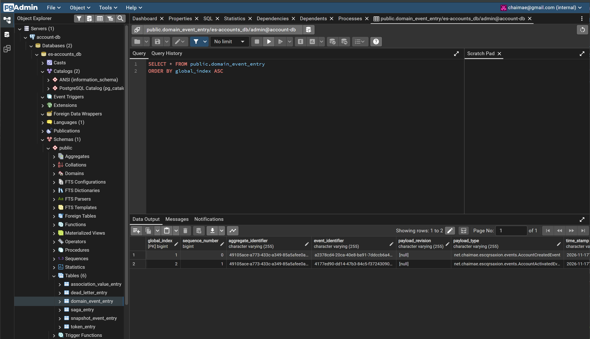
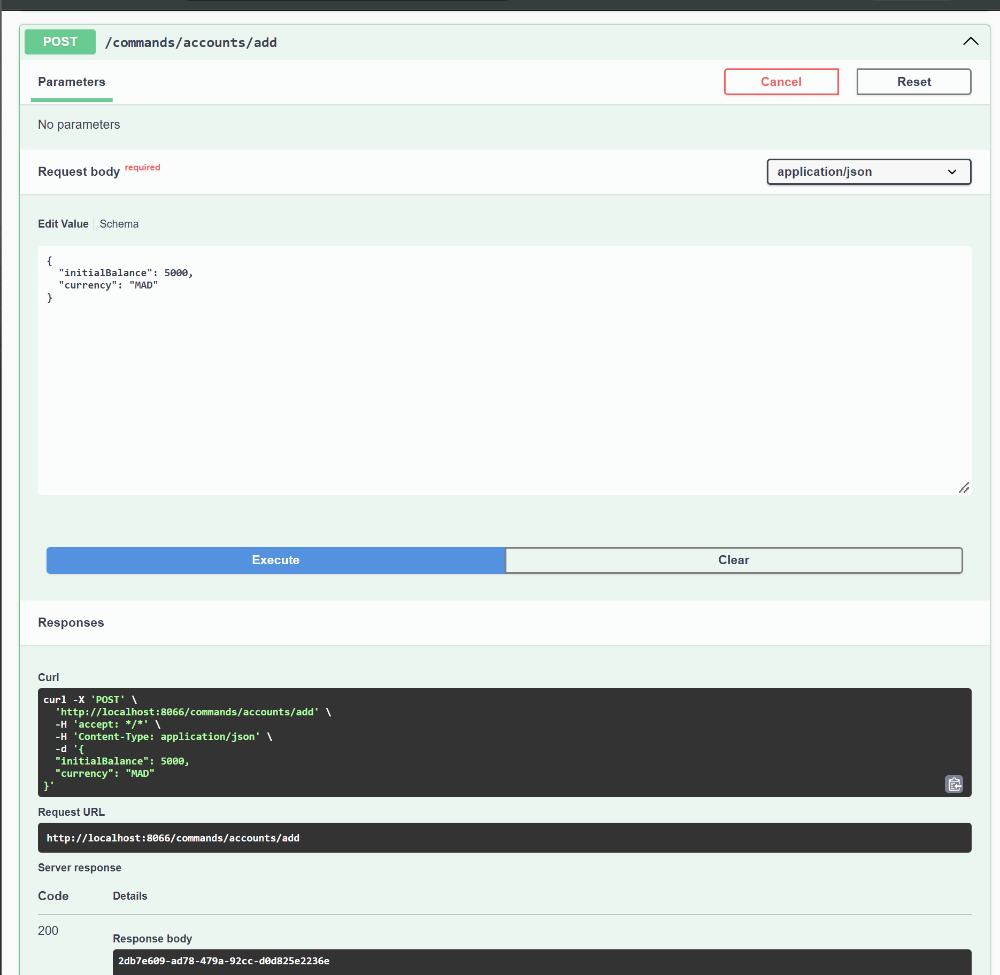
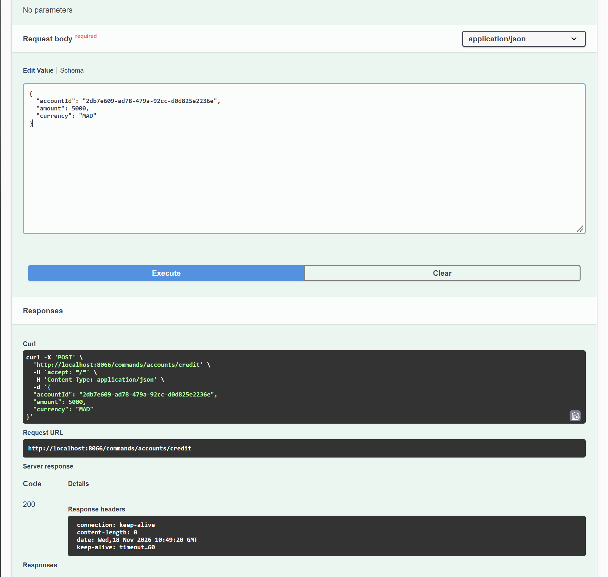
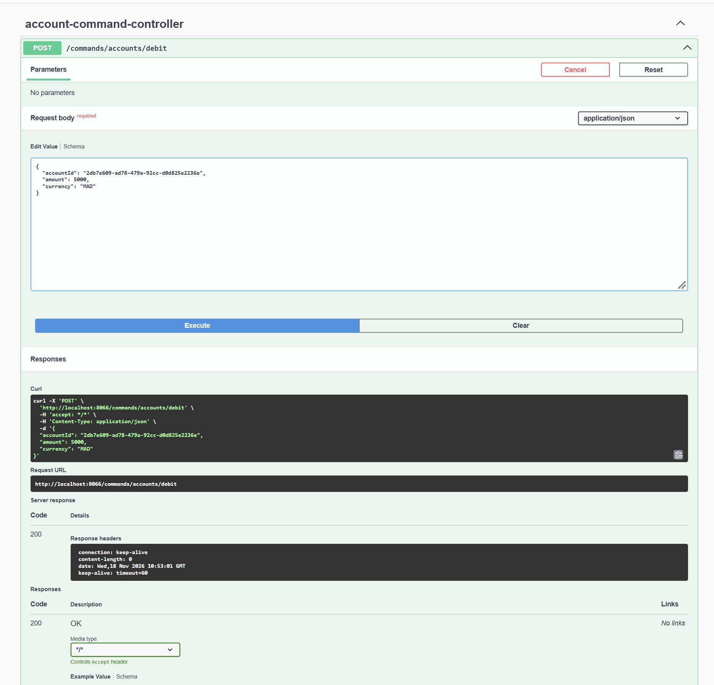
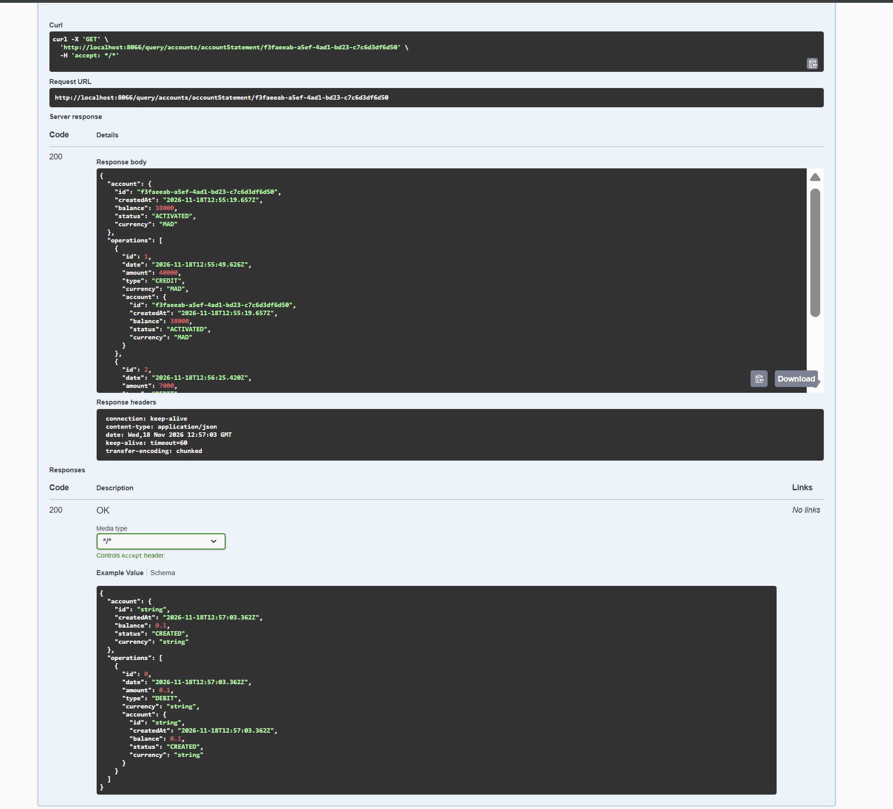
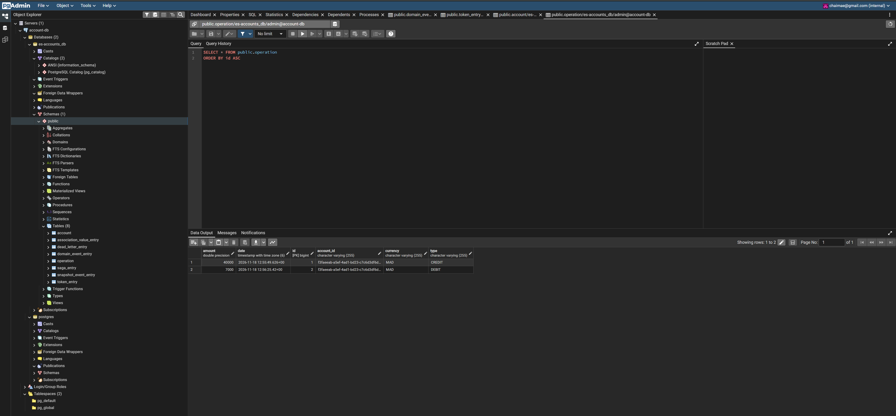

"# Event-Sourcing-CQRS-axion" 
# /commands/accounts/add

postgres 

view all rows 

## cree un account 

## crediter un account 

## debiter un account 

commands/accounts/events/{accountId}

or from the navigator  localhost:8066/commands/accounts/events/{accountId}

WHEN i set that the account is suspended 

for the query 
watch query 

in the pg admin

http://localhost:8066/commands/accounts/events/f3faeeab-a5ef-4ad1-bd23-c7c6d3df6d50
